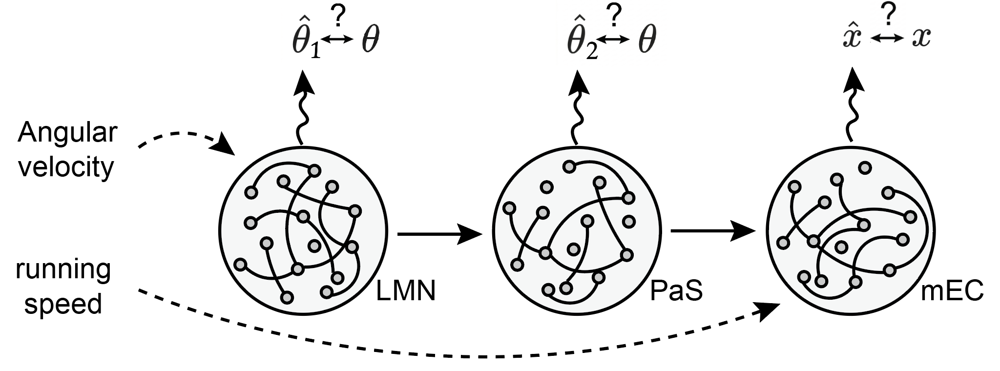
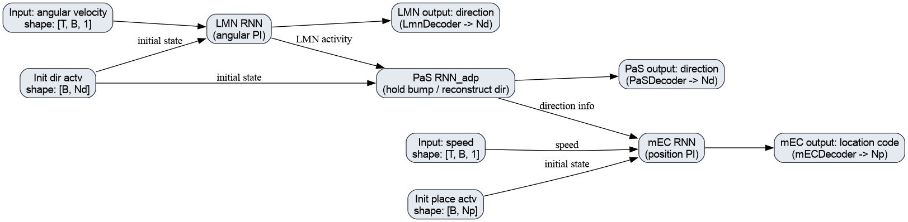

# The limbic navigation system as a hierarchical RNN

Code, data, and trained checkpoints for the hierarchical recurrent neural
network used for path integration and theta-sweep analyses. The model follows
the hierarchy LMN → PaS → conjunctive mEC → mEC.

## Quick start

Run the following commands from the repository root (`HRNN4PI`):

```bash
python -m venv .venv
source .venv/bin/activate
python -m pip install --upgrade pip
python -m pip install -r requirements.txt
jupyter lab
```

Open a notebook whose name starts with `PaperFigure`. Keep the working
directory at the repository root because the notebooks use relative paths such
as `./models_4layer/`, `./empirical_data/`, and `./docs/`.

The included checkpoints are sufficient for the analysis notebooks; retraining
is not required when the checkpoint directories are present. CPU execution is
supported. Some analyses use large batches and long trajectories, so a
CUDA-enabled PyTorch installation can substantially reduce runtime.

Generated figures are written to `docs/`. Existing files with the same names
may be overwritten when a notebook is rerun.

## Notebooks

- `PaperFigure_empirical.ipynb`: analysis of the empirical directional and
  grid-sweep data in `empirical_data/`.
- `PaperFigure_thetasweeps.ipynb`: directional, positional, and aligned theta
  sweep analyses.
- `PaperFigure_anatomical_motifs.ipynb`: anatomical motif and layer-to-layer
  connectivity analyses.
- `PaperFigure_celltypes.ipynb`: cell-type, tuning, speed, and grid-score
  analyses.
- `PaperFigure_knockOut.ipynb`: knockout analyses using the bundled four-layer
  checkpoint and saved summary data in `simulated_data/`.
- `PaperFigure_trainingpeformance.ipynb`: training-performance plots. The
  filename spelling is retained for compatibility with the release.

Run notebooks in a fresh kernel when switching between analyses. The
notebooks modify options such as batch size and sequence length during
execution.

## Checkpoints

- `models_4layer/` contains the four-layer checkpoints used by the main model
  analyses, including 101-epoch and 201-epoch runs.
- `models_4layer_laststepgradient/` contains the 201-epoch checkpoint used by
  `PaperFigure_trainingpeformance.ipynb`.

The checkpoint paths are generated from the options in each notebook. If a
checkpoint is missing, the notebook may fall back to training, which can take
substantial time and requires writable output directories.

## Repository contents

- `models.py`, `trainer.py`, `trainmodel.py`, `place_cells.py`,
  `direction_cells.py`, and `trajectory_generator*.py`: model, training, and
  trajectory-generation code.
- `visualize.py`, `scores.py`, and `utils.py`: activity, ratemap, scoring, and
  plotting utilities.
- `empirical_data/`: empirical input data.
- `simulated_data/` and `Data/`: simulated inputs and saved analysis summaries.
- `docs/`: included figures and notebook output figures.
- `requirements.txt`: Python dependencies.

## Model schematic




